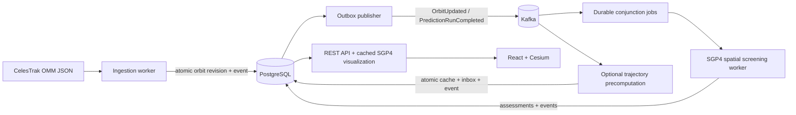

# Orbital Sentinel

[](https://github.com/igor-couto/orbital-sentinel/actions/workflows/ci.yml)


A real-time space traffic monitoring, conjunction analysis, and collision-avoidance simulation platform built with .NET.


This is an engineering demonstrator, **not a system for operational spacecraft decisions**. Obviously. I'm just a random guy on the internet. Public general-perturbation elements, an approximate coordinate conversion, and the absence of covariance information limit what can be concluded from its predictions.

## What works

- OMM-compatible JSON from all public groups on CelesTrak's current-data page, discovered automatically and deduplicated by NORAD ID, with an optional object limit.
- Internal UUID identities; optional NORAD IDs remain external identifiers. Orbital elements are immutable revisions, detected using a canonical fingerprint of every dynamical field.
- Transactional state + outbox writes, concurrent publication leases, per-object ordering, finite publication attempts, durable quarantine, and atomic consumer inbox + trajectory + outgoing-event writes.
- SGP4 visualization: shared current positions and on-demand 24-hour trajectories at 60-second intervals, with direct position/velocity propagation. An optional Kafka-driven precomputation mode remains available for smaller catalogs.
- A bounded in-memory cache of selected paths; regeneration does not erase orbital-element history.
- REST catalog/search/pagination, object details, current sample positions, trajectory retrieval, ProblemDetails, and OpenAPI.
- SignalR trajectory-availability notifications, with REST reconciliation when notifications are missed.
- React/TypeScript/Cesium Earth, selection, predicted path, time preview, element freshness, and honest loading/failure states. Earth imagery and Cesium assets are served locally.
- Real PostgreSQL/Kafka integration tests, reference-vector tests, source-adapter tests, and CI.
- Coherent prediction runs with in-memory TEME screening, direct-SGP4 TCA refinement, immutable conjunction assessments, and separate identification/reassessment events.
- A Conjunctions view with pair trajectories, assessment history, and an isolated deterministic crossing-orbits simulation.

OMM feeds often omit object type. A supplied `OBJECT_TYPE` takes precedence; when it is missing, null, or blank, the importer falls back to clear [CelesTrak naming markers](https://celestrak.org/satcat/satcat-format.php): a terminal `DEB` becomes **Debris**, and `R/B` or a numbered stage such as `R/B(2)` becomes **Rocket Body**. Trailing alternate names and bracketed descriptions do not supply a classification themselves. Conflicting markers, attached objects (`&`), platforms (`PLAT`), and names without a clear category remain **Unclassified**; a name without `DEB` or `R/B` is not assumed to be a payload. Explicit source types, including unknown or unsupported values, are never replaced by a name inference. The frontend also recognizes SATCAT type codes `PAY`, `R/B`, `DEB`, and `UNK`.

Existing records acquire the fallback classification on the next successful scheduled import (every two hours by default), even when their orbital elements have not changed. A group-based selection gives a useful variety but does not guarantee a particular number of each type.

The Object details panel includes NORAD/COSPAR identifiers, country or owner, launch date/site, operational status, type, altitude, speed, approximate perigee/apogee, period, inclination, element epoch/source, and imported catalog groups. A separate worker caches [CelesTrak SATCAT](https://celestrak.org/satcat/satcat-format.php) metadata daily for the configured CelesTrak groups. `SatelliteCatalog:BaseUrl` defaults to the official records endpoint; `SatelliteCatalog:RequestIntervalMinutes` defaults to 1440 and must be at least 120. Durable per-group schedules prevent repeated downloads after restarts; failed downloads retain the cache and do not block orbital ingestion. Definite SATCAT types fill previously unknown catalog classifications consistently across the list, globe, and details. Operator information is shown only for identified constellation groups; absent metadata remains explicitly unavailable.

Altitude is WGS84 geodetic height and speed is the magnitude of the SGP4 TEME velocity, sampled by the backend and interpolated at the displayed time. Speed is not inferred from adjacent positions or presented as ground speed. Approximate mean-orbit apsides use WGS84 constants and the current element revision, rather than mixing in a different catalog's orbit. Existing trajectory caches are refreshed after migration to populate the additional scalar measurements.

## Architecture

The implemented stack is .NET 10/C#/ASP.NET Core, Dapper/Npgsql, PostgreSQL 17, Apache Kafka, SGP.NET, React/TypeScript, CesiumJS, SignalR, and Docker Compose. xUnit and Testcontainers verify the backend. Vitest verifies browser data handling. Package versions are pinned in project files and committed lockfiles.

A modular monolith shares domain and infrastructure code between two independently hosted processes. The API reads the catalog, calculates cached visualization positions and selected paths, and accepts predefined simulation requests. Workers own ingestion, conjunction scans, optional trajectory precomputation, and message delivery. Kafka moves a completed prediction context into a durable conjunction scan; visualization uses the stored orbital elements directly by default.



| Location | Responsibility |
| --- | --- |
| `src/OrbitalSentinel.Core` | Orbital elements, identity, state-vector and propagation contracts; no infrastructure dependencies |
| `src/OrbitalSentinel.Propagation` | SGP.NET adapter and explicitly approximate visualization conversion |
| `src/OrbitalSentinel.Infrastructure` | Catalog SQL, embedded migrations, source adapter, outbox/inbox and cache persistence |
| `src/OrbitalSentinel.Runtime` | Shared configuration, visualization cache, conjunction application, Kafka setup, health checks and diagnostics |
| `src/OrbitalSentinel.Api` | Read endpoints and browser-facing SignalR relay |
| `src/OrbitalSentinel.Workers` | Ingestion and metadata schedules, outbox delivery, Kafka consumers and conjunction screening |
| `src/orbital-sentinel-web` | API clients, view models, React components, Cesium rendering |
| `tests` | Unit, PostgreSQL/source-adapter integration, and Kafka/API end-to-end checks |

There is no generic repository, service layer hierarchy, EF Core dependency, or speculative microservice boundary. Dapper executes parameterized SQL; integration tests exercise PostgreSQL mappings and transactions directly.

## Orbital processing

The application explicitly asks for `FORMAT=JSON`. CelesTrak JSON uses OMM field names and definitions but is not the standardized OMM XML serialization. It may omit Earth/TEME/UTC/SGP4 metadata; explicit conflicting values are rejected. Required numeric values cannot silently become zero, and both JSON numbers and numeric strings are supported. [CelesTrak format documentation](https://celestrak.org/NORAD/documentation/gp-data-formats.php).

CelesTrak group discovery reads only GP links from the official current-data page, caches the list for 24 hours, and falls back to the last known list (47 groups verified on 2026-10-13). This combines all published groups, not the complete Space-Track catalog. A durable per-group schedule permits downloads at most once per two hours across worker instances and restarts. New groups can start immediately while the original three retain their existing cooldown. Downloads are sequential with one-second spacing, bounded retries/timeouts, and a 64 MiB per-response safety bound. Failed groups retain stored objects; healthy groups still import, and overlapping feeds use the newest element epoch. Forbidden or rate-limited responses stop the remaining batch. Individual malformed records are logged and rejected.

SGP.NET 1.6.0 maps numerical OMM values directly into its propagator without a formatted TLE round trip. **SGP4 state vectors are TEME Cartesian kilometres and kilometres/second**, not latitude/longitude/altitude. Only the visualization boundary rotates position using GMST and converts kilometres to metres for Cesium's fixed frame. Earth-fixed velocity includes the Earth-rotation term (`R v − ω × r`), in metres/second. It assumes UT1≈UTC and omits polar motion, so this is approximate Earth-fixed positioning, not precise ITRF.

The API shares a short full-catalog motion buffer across clients through `/api/orbital-objects/motion`: five SGP4 position/velocity samples per object, 30 seconds apart over a two-minute window. A new coherent catalog snapshot and buffer are calculated at most once per UTC minute; ETags avoid retransmitting unchanged buffers. The browser checks every 30 seconds, uses cubic Hermite interpolation at the current display time, and uploads catalog marker positions in a single batch at a target of 30 frames per second. It performs no SGP4 calculations. Slow graphics devices reduce canvas resolution rather than dropping objects, and hidden tabs pause rendering. Objects that cannot propagate are excluded from that buffer and counted in logs. Expired buffers are not extrapolated.

Full paths are calculated only when viewed and cached in memory (up to 32 entries, two minutes, keyed by object, orbit version and start minute). This avoids persisting tens of millions of unused samples. With `Prediction:PrecomputeTrajectories=true`, the original Kafka-driven database cache and trajectory notifications remain available. The older `/positions` endpoint remains supported, but the dashboard uses motion buffers. The selected marker and its path share a display clock; preview and conjunction views use their explicit frozen time and hide other catalog objects to avoid mixing times. Older persisted trajectories without velocity retain linear interpolation.

Conjunction screening streams two adjacent time slices through a spatial grid of expanded forward/reverse tangent bounds, then applies the existing relative-motion screen and direct-SGP4 refinement. The numerical reference implementation remains available to parity tests. Large bounds fall back to complete comparisons rather than being dropped. Only connected candidate windows are retained in memory. Real objects that fail propagation are excluded for the entire run and counted in persisted metrics and a visible **Partial screening coverage** notice; simulation failures remain explicit failures. The scan timeout remains in force. `PairCount` and `IntervalCount` describe possible input comparisons; `NarrowPhaseIntervalCount` records comparisons surviving the spatial filter.

## Messaging and failure behavior

The database transaction, not a Kafka producer call, is the commit point for a business change. An outbox publisher claims up to 16 eligible messages with `FOR UPDATE SKIP LOCKED` and starts their publication together. Claims contain at most one pending event per partition key, preserving per-object and per-encounter order. Each acknowledgement requires its current lease. Partial indexes cover pending sequence and partition order so a full-catalog import does not repeatedly scan published history. A crash after Kafka accepts the message but before PostgreSQL acknowledges it causes redelivery. **This is at-least-once delivery, not exactly-once processing.**

Object UUIDs are Kafka keys. The durable propagation consumer records `(consumer_name, event_id)` and its business changes atomically. Version checks stop delayed updates from replacing newer predictions. After eight failed/expired publication attempts, a message is retained in a dead-letter state so it cannot block subsequent work forever. Known invalid messages are quarantined immediately; unexpected processing errors have three attempts. Database/Kafka outages leave offsets uncommitted and are retried by background service recovery.

SignalR carries a small `TrajectoryAvailable` client contract, not trajectory arrays or internal event payloads. Each API instance uses its own Kafka notification group, so all instances can notify their connected clients. Notifications are advisory: startup, disconnects, and duplicates are handled by browser polling. Multi-instance SignalR deployments require session affinity unless clients use WebSockets exclusively with negotiation skipped; see the deployment notes.

## Run locally

Requires Docker Desktop with Linux containers, or Docker Engine with Compose. No Cesium ion account, API key, or local .NET installation is required for the containerized app.

```sh
docker compose up --build -d
```

Open [the dashboard](http://localhost:8088). The [OpenAPI document](http://localhost:5080/openapi/v1.json) and [readiness endpoint](http://localhost:5080/health/ready) are also available. Set `WEB_PORT` in `.env` if port 8088 is occupied.

The first build downloads images and packages. The worker retrieves the configured CelesTrak groups after startup; predictions then appear asynchronously. If upstream data cannot be fetched, the UI shows an empty catalog rather than invented objects. Check `docker compose logs workers`. Existing data survives application restarts in named PostgreSQL and Kafka volumes.

```sh
docker compose ps
docker compose logs --tail=100 workers
docker compose down
```

`down` preserves the data volumes. The committed password is a disposable **local-only** default, and exposed ports bind to loopback. Copy `.env.example` to `.env` to override it.

## Develop without application containers

Install a **stable .NET 10 SDK**, Node.js 22.12+ (24 recommended), and Docker. `global.json` deliberately does not accept .NET preview SDKs. The initial workstation contained only a .NET 10 release candidate, so a stable SDK was installed into the ignored `.local/dotnet` directory for verification; it does not change the machine-wide SDK.

```sh
docker compose up -d postgres kafka
dotnet build OrbitalSentinel.slnx
```

In each backend terminal, set `ConnectionStrings__Postgres` to `Host=localhost;Port=15432;Database=orbital_sentinel;Username=orbital;Password=orbital_local_only` (or your `.env` password), then run:

```sh
dotnet run --project src/OrbitalSentinel.Api --urls http://localhost:5080
dotnet run --project src/OrbitalSentinel.Workers --urls http://localhost:5081
```

These commands run in separate terminals. On PowerShell, environment assignment is `$env:ConnectionStrings__Postgres = '...'`; on POSIX shells it is `export ConnectionStrings__Postgres='...'`. Stop the Compose API/workers if already running before starting local hosts.

```sh
cd src/orbital-sentinel-web
npm ci
npm run dev
```

The dev server proxies API and SignalR requests to `http://localhost:5080`. No CORS exception is needed. SQL migrations run at host startup under a PostgreSQL advisory transaction lock; migration checksums detect edits to already-applied scripts. Deployment should run migrations as a separately controlled step with a restricted application role.

## Configuration

Strongly typed options validate on startup. Standard .NET environment variables use `__` to separate path components.

| Setting | Default / meaning |
| --- | --- |
| `ConnectionStrings__Postgres` | Required outside Compose; no application-source secret |
| `CelesTrak__BaseUrl` | `https://celestrak.org/NORAD/elements/gp.php` |
| `CelesTrak__DiscoverPublicGroups` | `true`; discover all groups published by CelesTrak |
| `CelesTrak__Groups__0` etc. | Manual selection when discovery is `false`; defaults to the 47 verified public groups |
| `CelesTrak__MaxObjects` | `0` (unlimited); a positive integer caps each import cycle |
| `CelesTrak__RequestIntervalMinutes` | 120 minimum |
| `CelesTrak__TimeoutSeconds` | 60 in worker settings |
| `CelesTrak__MaxRetries` | 2, after the original HTTP attempt |
| `Prediction__HorizonHours` | 24; configurable 1–48 |
| `Prediction__StepSeconds` | 60; configurable 30–600 |
| `Prediction__PrecomputeTrajectories` | `false`; set `true` to restore the per-object database trajectory cache |
| `Kafka__BootstrapServers` | `localhost:19092` locally; `kafka:9092` in Compose |
| `Kafka__OrbitTopic` | `orbital-sentinel.orbits.v1` |
| `Kafka__TrajectoryTopic` | `orbital-sentinel.trajectory-updated.v1` |
| `Kafka__DeadLetterTopic` | `orbital-sentinel.dead-letter.v1` |
| `Kafka__PropagationGroup` | `orbital-sentinel-propagation-v1` |
| `Kafka__Partitions` | 3, applied at initial topic creation |
| `SignalR__KeepAliveSeconds` | 15 |
| `SignalR__ClientTimeoutSeconds` | 45 |

Both Compose configurations expose the import limit as `CELESTRAK_MAX_OBJECTS` in `.env`: `0` imports every valid, distinct object from all due groups; e.g. `500` restores a per-cycle cap. A cap does not delete previously ingested objects or their history. The browser loads all catalog pages, mounts only visible list rows, and conjunction runs include the full stored catalog. Screening cost still depends on object density and encounter count; the spatial filter does not guarantee a fixed runtime on a Raspberry Pi.

Production Compose allows up to 60 minutes per scan and assessment publication to accommodate the Raspberry Pi (`CONJUNCTION_MAX_SCAN_MINUTES`, range 1–60); the local default remains 15 minutes. Lease renewals continue while assessments are saved, and a final token/expiry check fences the atomic commit. A timed-out run reports failure and never claims a successful empty result.

The conjunction view retains the latest completed, unexpired real screening while a newer run is queued or calculating. It labels that choice and switches once fresh results are complete; expired windows are never presented as current coverage.

## Tests and observability

```sh
dotnet test OrbitalSentinel.slnx
dotnet list OrbitalSentinel.slnx package --vulnerable --include-transitive
cd src/orbital-sentinel-web
npm test
npm run build
npm audit
```

Docker must be running for integration and end-to-end tests. Testcontainers uses disposable PostgreSQL and Kafka instances; tests do not need CelesTrak access and do not alter the Compose catalog. Unit tests cover domain validation, fingerprint stability, SGP4 reference vectors, coordinates, prediction bounds, and cancellation. Integration tests cover real transactions, rollback injection, migration checksums, leases, duplicate/stale events, quarantine, schedules, and malformed/transient HTTP responses. End-to-end tests traverse outbox → Kafka → SGP4 → cache/outbox → API and notifications.

Hosts expose `/health/live` and `/health/ready`; readiness checks PostgreSQL and Kafka, not source freshness or consumer lag. Structured logs contain event/object/correlation IDs and Kafka positions, without trajectory arrays. The `OrbitalSentinel` .NET Meter exposes ingestion changes/failures, propagation duration/completions, publication failures, quarantine counts, and conjunction workload/duration/failure measurements. ActivitySource spans cover ingestion, propagation, and conjunction scans. Prediction-run status is queryable through the API. An OTLP exporter, consumer-lag dashboard, and freshness alarms remain future work.

## Author

* **Igor Couto** - [igor.fcouto@gmail.com](mailto:igor.fcouto@gmail.com)
