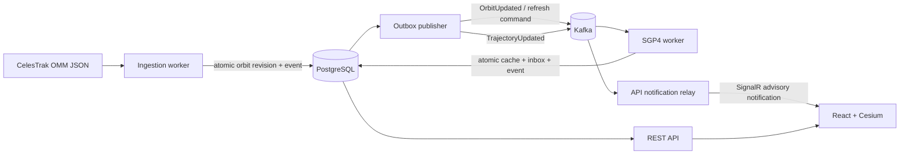

# Orbital Sentinel

[](https://github.com/igor-couto/orbital-sentinel/actions/workflows/ci.yml)


A real-time space traffic monitoring, conjunction analysis, and collision-avoidance simulation platform built with .NET.


This is an engineering demonstrator, **not a system for operational spacecraft decisions**. Obviously. I'm just a random guy on the internet. Public general-perturbation elements, an approximate coordinate conversion, and the absence of covariance information limit what can be concluded from its predictions.

## What works

- OMM-compatible JSON from CelesTrak, validated through a separate external DTO, with a bounded 500-object selection.
- Internal UUID identities; optional NORAD IDs remain external identifiers. Orbital elements are immutable revisions, detected using a canonical fingerprint of every dynamical field.
- Transactional state + outbox writes, concurrent publication leases, per-object ordering, finite publication attempts, durable quarantine, and atomic consumer inbox + trajectory + outgoing-event writes.
- Kafka-driven SGP4 predictions: default 24-hour horizon at 60-second intervals, including position and velocity at a requested instant through the propagation abstraction.
- A bounded, replaceable trajectory cache; regeneration does not erase orbital-element history.
- REST catalog/search/pagination, object details, current sample positions, trajectory retrieval, ProblemDetails, and OpenAPI.
- SignalR trajectory-availability notifications, with REST reconciliation when notifications are missed.
- React/TypeScript/Cesium Earth, selection, predicted path, time preview, element freshness, and honest loading/failure states. Earth imagery and Cesium assets are served locally.
- Real PostgreSQL/Kafka integration tests, reference-vector tests, source-adapter tests, and CI.
- Coherent prediction runs with in-memory TEME screening, direct-SGP4 TCA refinement, immutable conjunction assessments, and separate identification/reassessment events.
- A Conjunctions view with pair trajectories, assessment history, and an isolated deterministic crossing-orbits simulation.

OMM feeds often omit object type. A supplied `OBJECT_TYPE` takes precedence; when it is missing, null, or blank, the importer falls back to clear [CelesTrak naming markers](https://celestrak.org/satcat/satcat-format.php): a terminal `DEB` becomes **Debris**, and `R/B` or a numbered stage such as `R/B(2)` becomes **Rocket Body**. Trailing alternate names and bracketed descriptions do not supply a classification themselves. Conflicting markers, attached objects (`&`), platforms (`PLAT`), and names without a clear category remain **Unclassified**; a name without `DEB` or `R/B` is not assumed to be a payload. Explicit source types, including unknown or unsupported values, are never replaced by a name inference. The frontend also recognizes SATCAT type codes `PAY`, `R/B`, `DEB`, and `UNK`.

Existing records acquire the fallback classification on the next successful scheduled import (every two hours by default), even when their orbital elements have not changed. No additional source polling or database reset is needed. Full SATCAT metadata enrichment remains planned. A group-based selection gives a useful variety but does not guarantee a particular number of each type.

## Architecture

The implemented stack is .NET 10/C#/ASP.NET Core, Dapper/Npgsql, PostgreSQL 17, Apache Kafka, SGP.NET, React/TypeScript, CesiumJS, SignalR, and Docker Compose. xUnit and Testcontainers verify the backend. Vitest verifies browser data handling. Package versions are pinned in project files and committed lockfiles.

A modular monolith shares domain and infrastructure code between two independently hosted processes. The API performs bounded reads and accepts predefined simulation requests; workers own ingestion, propagation, conjunction scans, and message delivery. Kafka is required to move an ingested change into a trajectory prediction and a completed prediction context into a durable conjunction scan.



| Location | Responsibility |
| --- | --- |
| `src/OrbitalSentinel.Core` | Orbital elements, identity, state-vector and propagation contracts; no infrastructure dependencies |
| `src/OrbitalSentinel.Propagation` | SGP.NET adapter and explicitly approximate visualization conversion |
| `src/OrbitalSentinel.Infrastructure` | Catalog SQL, embedded migrations, source adapter, outbox/inbox and cache persistence |
| `src/OrbitalSentinel.Runtime` | Shared host configuration, Kafka setup, health checks, diagnostic instruments |
| `src/OrbitalSentinel.Api` | Read endpoints and browser-facing SignalR relay |
| `src/OrbitalSentinel.Workers` | Ingestion schedule, outbox delivery, Kafka propagation consumer |
| `src/orbital-sentinel-web` | API clients, view models, React components, Cesium rendering |
| `tests` | Unit, PostgreSQL/source-adapter integration, and Kafka/API end-to-end checks |

There is no generic repository, service layer hierarchy, EF Core dependency, or speculative microservice boundary. Dapper executes parameterized SQL; integration tests exercise PostgreSQL mappings and transactions directly.

## Orbital processing

The application explicitly asks for `FORMAT=JSON`. CelesTrak JSON uses OMM field names and definitions but is not the standardized OMM XML serialization. It may omit Earth/TEME/UTC/SGP4 metadata; explicit conflicting values are rejected. Required numeric values cannot silently become zero, and both JSON numbers and numeric strings are supported. [CelesTrak format documentation](https://celestrak.org/NORAD/documentation/gp-data-formats.php).

A durable database schedule permits one ingestion cycle per two hours across worker instances and restarts. HTTP timeouts, bounded transient retries, response-size limits, cancellation, and structured errors protect ingestion. 403/404 responses are never retried within a cycle. A partial failed multi-group download does not replace the existing catalog. Individual malformed records are logged and rejected; healthy records remain usable.

SGP.NET 1.6.0 maps numerical OMM values directly into its propagator without a formatted TLE round trip. **SGP4 state vectors are TEME Cartesian kilometres and kilometres/second**, not latitude/longitude/altitude. Only the visualization boundary rotates position using GMST and converts kilometres to metres for Cesium's fixed frame. It assumes UT1≈UTC and omits polar motion, so this is approximate Earth-fixed positioning, not precise ITRF.

Only the most recent trajectory per object is cached (typically 1,441 samples). A refresh command extends its window even when upstream elements are unchanged. Historical element revisions are retained. The current-position endpoint returns the nearest cached sample **with that sample's actual timestamp**, potentially up to half an interval before or after now. The browser interpolates only the selected object's cached samples for display; it does not implement SGP4. Preview mode hides other objects to avoid implying a synchronized scene at an unrelated time.

## Messaging and failure behavior

The database transaction, not a Kafka producer call, is the commit point for a business change. An outbox publisher claims a single eligible message with `FOR UPDATE SKIP LOCKED`, publishes it, and marks it published only while it still owns the lease. A crash after Kafka accepts the message but before PostgreSQL acknowledges it causes redelivery. **This is at-least-once delivery, not exactly-once processing.**

Object UUIDs are Kafka keys. The durable propagation consumer records `(consumer_name, event_id)` and its business changes atomically. Version checks stop delayed updates from replacing newer predictions. After eight failed/expired publication attempts, a message is retained in a dead-letter state so it cannot block subsequent work forever. Known invalid messages are quarantined immediately; unexpected processing errors have three attempts. Database/Kafka outages leave offsets uncommitted and are retried by background service recovery.

SignalR carries a small `TrajectoryAvailable` client contract, not trajectory arrays or internal event payloads. Each API instance uses its own Kafka notification group, so all instances can notify their connected clients. Notifications are advisory: startup, disconnects, and duplicates are handled by browser polling. Multi-instance SignalR deployments require session affinity unless clients use WebSockets exclusively with negotiation skipped; see the deployment notes.

## Run locally

Requires Docker Desktop with Linux containers, or Docker Engine with Compose. No Cesium ion account, API key, or local .NET installation is required for the containerized app.

```sh
docker compose up --build -d
```

Open [the dashboard](http://localhost:8088). The [OpenAPI document](http://localhost:5080/openapi/v1.json) and [readiness endpoint](http://localhost:5080/health/ready) are also available. Set `WEB_PORT` in `.env` if port 8088 is occupied.

The first build downloads images and packages. The worker retrieves the configured CelesTrak groups after startup; predictions then appear asynchronously. If upstream data cannot be fetched, the UI shows an empty catalog rather than invented objects. Check `docker compose logs workers`. Existing data survives application restarts in named PostgreSQL and Kafka volumes.

```sh
docker compose ps
docker compose logs --tail=100 workers
docker compose down
```

`down` preserves the data volumes. The committed password is a disposable **local-only** default, and exposed ports bind to loopback. Copy `.env.example` to `.env` to override it.

## Develop without application containers

Install a **stable .NET 10 SDK**, Node.js 22.12+ (24 recommended), and Docker. `global.json` deliberately does not accept .NET preview SDKs. The initial workstation contained only a .NET 10 release candidate, so a stable SDK was installed into the ignored `.local/dotnet` directory for verification; it does not change the machine-wide SDK.

```sh
docker compose up -d postgres kafka
dotnet build OrbitalSentinel.slnx
```

In each backend terminal, set `ConnectionStrings__Postgres` to `Host=localhost;Port=15432;Database=orbital_sentinel;Username=orbital;Password=orbital_local_only` (or your `.env` password), then run:

```sh
dotnet run --project src/OrbitalSentinel.Api --urls http://localhost:5080
dotnet run --project src/OrbitalSentinel.Workers --urls http://localhost:5081
```

These commands run in separate terminals. On PowerShell, environment assignment is `$env:ConnectionStrings__Postgres = '...'`; on POSIX shells it is `export ConnectionStrings__Postgres='...'`. Stop the Compose API/workers if already running before starting local hosts.

```sh
cd src/orbital-sentinel-web
npm ci
npm run dev
```

The dev server proxies API and SignalR requests to `http://localhost:5080`. No CORS exception is needed. SQL migrations run at host startup under a PostgreSQL advisory transaction lock; migration checksums detect edits to already-applied scripts. Deployment should run migrations as a separately controlled step with a restricted application role.

## Configuration

Strongly typed options validate on startup. Standard .NET environment variables use `__` to separate path components.

| Setting | Default / meaning |
| --- | --- |
| `ConnectionStrings__Postgres` | Required outside Compose; no application-source secret |
| `CelesTrak__BaseUrl` | `https://celestrak.org/NORAD/elements/gp.php` |
| `CelesTrak__Groups__0` etc. | `stations`, `visual`, `iridium-33-debris` |
| `CelesTrak__MaxObjects` | 500 per cycle; configurable 1–500 |
| `CelesTrak__RequestIntervalMinutes` | 120 minimum |
| `CelesTrak__TimeoutSeconds` | 20 in worker settings |
| `CelesTrak__MaxRetries` | 2, after the original HTTP attempt |
| `Prediction__HorizonHours` | 24; configurable 1–48 |
| `Prediction__StepSeconds` | 60; configurable 30–600 |
| `Kafka__BootstrapServers` | `localhost:19092` locally; `kafka:9092` in Compose |
| `Kafka__OrbitTopic` | `orbital-sentinel.orbits.v1` |
| `Kafka__TrajectoryTopic` | `orbital-sentinel.trajectory-updated.v1` |
| `Kafka__DeadLetterTopic` | `orbital-sentinel.dead-letter.v1` |
| `Kafka__PropagationGroup` | `orbital-sentinel-propagation-v1` |
| `Kafka__Partitions` | 3, applied at initial topic creation |
| `SignalR__KeepAliveSeconds` | 15 |
| `SignalR__ClientTimeoutSeconds` | 45 |

## Tests and observability

```sh
dotnet test OrbitalSentinel.slnx
dotnet list OrbitalSentinel.slnx package --vulnerable --include-transitive
cd src/orbital-sentinel-web
npm test
npm run build
npm audit
```

Docker must be running for integration and end-to-end tests. Testcontainers uses disposable PostgreSQL and Kafka instances; tests do not need CelesTrak access and do not alter the Compose catalog. Unit tests cover domain validation, fingerprint stability, SGP4 reference vectors, coordinates, prediction bounds, and cancellation. Integration tests cover real transactions, rollback injection, migration checksums, leases, duplicate/stale events, quarantine, schedules, and malformed/transient HTTP responses. End-to-end tests traverse outbox → Kafka → SGP4 → cache/outbox → API and notifications.

Hosts expose `/health/live` and `/health/ready`; readiness checks PostgreSQL and Kafka, not source freshness or consumer lag. Structured logs contain event/object/correlation IDs and Kafka positions, without trajectory arrays. The `OrbitalSentinel` .NET Meter exposes ingestion changes/failures, propagation duration/completions, publication failures, quarantine counts, and conjunction workload/duration/failure measurements. ActivitySource spans cover ingestion, propagation, and conjunction scans. Prediction-run status is queryable through the API. An OTLP exporter, consumer-lag dashboard, and freshness alarms remain future work.

## Author

* **Igor Couto** - [igor.fcouto@gmail.com](mailto:igor.fcouto@gmail.com)
