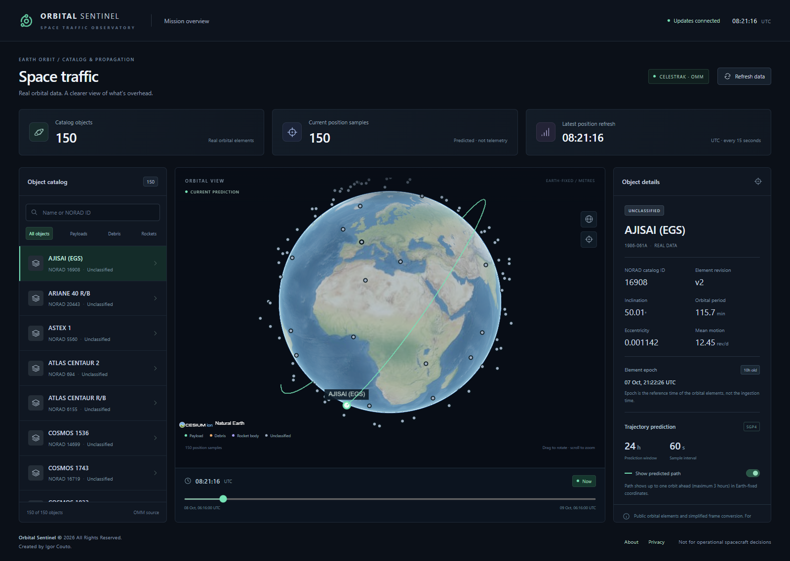
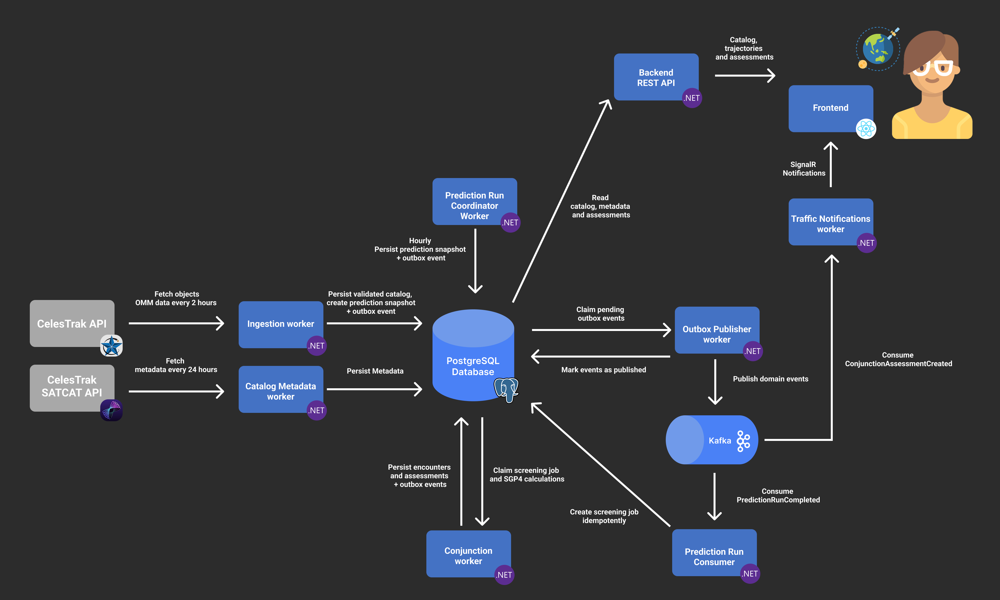

# Orbital Sentinel

[](https://github.com/igor-couto/orbital-sentinel/actions/workflows/ci.yml)


A real-time space traffic monitoring, conjunction analysis, and collision-avoidance simulation platform built with .NET.



This is an engineering demonstrator, **not a system for operational spacecraft decisions**. Obviously. I'm just a random guy on the internet. Public general-perturbation elements, an approximate coordinate conversion, and the absence of covariance information limit severely what can be concluded from its predictions.

## Features

- **Interactive 3D Earth:** Explore satellites, rocket bodies, and debris with smoothly animated positions predicted from CelesTrak orbital data.
- **Search and filter:** Find objects by name or NORAD ID and filter the catalog by object type.
- **Detailed object profiles:** Inspect altitude, speed, orbital characteristics, and available launch, ownership, and status information.
- **24-hour previews:** Move along a timeline to see where a selected object is predicted to be.
- **Two orbital views:** Switch between an orbit around Earth and a path relative to Earth's rotation.
- **Close-approach analysis:** Explore predicted encounters, compare both objects' paths, and inspect the closest-approach time, separation, and relative speed.
- **Assessment history:** See how predictions for the same encounter change as new assessments become available.
- **Simulated encounters:** Run a predefined crossing-orbits scenario to explore conjunction detection, separate from the real catalog.
- **Data freshness and coverage:** See the age of orbital data, expired predictions, and notices when screening could not cover every object.

## Architecture

The implemented stack is .NET 10/C#/ASP.NET Core, Dapper/Npgsql, PostgreSQL 17, Apache Kafka, SGP.NET, React/TypeScript, CesiumJS, SignalR, and Docker Compose. xUnit and Testcontainers verify the backend. Vitest verifies browser data handling.



## Orbital processing

Orbital Sentinel ingests validated CelesTrak JSON using OMM field definitions. It discovers public groups, deduplicates objects using the newest element epoch, and schedules downloads at most once every two hours per group. Failed downloads preserve existing data; access restrictions stop the batch. Coverage does not equal the complete Space-Track catalog.

The backend uses SGP4 to calculate TEME positions and velocities, then converts them into approximate Earth-fixed coordinates for visualization. This conversion accounts for Earth’s rotation but is not precise ITRF.

Smooth movement uses shared two-minute motion buffers refreshed once per minute. The browser interpolates backend samples at a target of 30 frames per second, without running SGP4 or extrapolating expired data.

Full trajectories are calculated on demand and briefly cached. With `Prediction:PrecomputeTrajectories=false` (the default), ingestion writes no orbit/trajectory-refresh events, the propagation consumer is not started, and trajectory topics are neither provisioned nor subscribed to. Previously queued trajectory-branch outbox events remain paused without consuming retry attempts; existing topics and data are retained. Conjunction events, screening, and notifications remain active. Markers and paths share a display clock, while preview and conjunction views isolate their selected time.

To restore database-backed trajectory precomputation, set `Prediction__PrecomputeTrajectories=true` for both API and workers and restart them. With either Compose configuration, set `PRECOMPUTE_TRAJECTORIES=true` in its `.env` and recreate the application containers. This resumes the optional branch; the existing refresh scheduler also queues missing or outdated trajectories for objects imported while it was disabled. It may take until the next scheduled refresh (up to 30 minutes) to enqueue them, followed by calculation time.

Conjunction screening uses spatial filtering to reduce candidate comparisons, followed by relative-motion checks and direct SGP4 refinement. Objects that cannot propagate are excluded and reported through a Partial screening coverage notice. Simulation failures remain explicit errors.

## Run locally

Requires Docker Desktop with Linux containers, or Docker Engine with Compose. No Cesium ion account, API key, or local .NET installation is required for the containerized app.

```sh
docker compose up --build -d
```

Open [the dashboard](http://localhost:8088). The [OpenAPI document](http://localhost:5080/openapi/v1.json) and [readiness endpoint](http://localhost:5080/health/ready) are also available. Set `WEB_PORT` in `.env` if port 8088 is occupied.

The first build downloads images and packages. The worker retrieves the configured CelesTrak groups after startup; predictions then appear asynchronously. If upstream data cannot be fetched, the UI shows an empty catalog rather than invented objects. Check `docker compose logs workers`. Existing data survives application restarts in named PostgreSQL and Kafka volumes.

```sh
docker compose ps
docker compose logs --tail=100 workers
docker compose down
```

`down` preserves the data volumes. The committed password is a disposable **local-only** default, and exposed ports bind to loopback. Copy `.env.example` to `.env` to override it.

## Develop without application containers

Install a **stable .NET 10 SDK**, Node.js 22.12+ (24 recommended), and Docker. `global.json` deliberately does not accept .NET preview SDKs. The initial workstation contained only a .NET 10 release candidate, so a stable SDK was installed into the ignored `.local/dotnet` directory for verification; it does not change the machine-wide SDK.

```sh
docker compose up -d postgres kafka
dotnet build OrbitalSentinel.slnx
```

In each backend terminal, set `ConnectionStrings__Postgres` to `Host=localhost;Port=15432;Database=orbital_sentinel;Username=orbital;Password=orbital_local_only` (or your `.env` password), then run:

```sh
dotnet run --project src/OrbitalSentinel.Api --urls http://localhost:5080
dotnet run --project src/OrbitalSentinel.Workers --urls http://localhost:5081
```

These commands run in separate terminals. On PowerShell, environment assignment is `$env:ConnectionStrings__Postgres = '...'`; on POSIX shells it is `export ConnectionStrings__Postgres='...'`. Stop the Compose API/workers if already running before starting local hosts.

```sh
cd src/orbital-sentinel-web
npm ci
npm run dev
```

The dev server proxies API and SignalR requests to `http://localhost:5080`. No CORS exception is needed. SQL migrations run at host startup under a PostgreSQL advisory transaction lock; migration checksums detect edits to already-applied scripts. Deployment should run migrations as a separately controlled step with a restricted application role.

## Configuration

Strongly typed options validate on startup. Standard .NET environment variables use `__` to separate path components.

| Setting | Default / meaning |
| --- | --- |
| `ConnectionStrings__Postgres` | Required outside Compose; no application-source secret |
| `CelesTrak__BaseUrl` | `https://celestrak.org/NORAD/elements/gp.php` |
| `CelesTrak__DiscoverPublicGroups` | `true`; discover all groups published by CelesTrak |
| `CelesTrak__Groups__0` etc. | Manual selection when discovery is `false`; defaults to the 47 verified public groups |
| `CelesTrak__MaxObjects` | `0` (unlimited); a positive integer caps each import cycle |
| `CelesTrak__RequestIntervalMinutes` | 120 minimum |
| `CelesTrak__TimeoutSeconds` | 60 in worker settings |
| `CelesTrak__MaxRetries` | 2, after the original HTTP attempt |
| `Prediction__HorizonHours` | 24; configurable 1–48 |
| `Prediction__StepSeconds` | 60; configurable 30–600 |
| `Prediction__PrecomputeTrajectories` | `false`; set `true` to restore the per-object database trajectory cache |
| `Kafka__BootstrapServers` | `localhost:19092` locally; `kafka:9092` in Compose |
| `Kafka__OrbitTopic` | `orbital-sentinel.orbits.v1` |
| `Kafka__TrajectoryTopic` | `orbital-sentinel.trajectory-updated.v1` |
| `Kafka__DeadLetterTopic` | `orbital-sentinel.dead-letter.v1` |
| `Kafka__PropagationGroup` | `orbital-sentinel-propagation-v1` |
| `Kafka__Partitions` | 3, applied at initial topic creation |
| `SignalR__KeepAliveSeconds` | 15 |
| `SignalR__ClientTimeoutSeconds` | 45 |

Both Compose configurations expose the import limit as `CELESTRAK_MAX_OBJECTS` in `.env`: `0` imports every valid, distinct object from all due groups; e.g. `500` restores a per-cycle cap. A cap does not delete previously ingested objects or their history. The browser loads the full catalog through one compact `/api/orbital-objects/catalog` response containing identities, display names, classifications, and orbital revision numbers. The API shares this snapshot across requests for 30 seconds, with one database read when it expires. Full orbital elements and SATCAT details are fetched only for the selected object; the existing paginated API remains available. The dashboard refreshes the catalog every five minutes, retries transient failures with a short backoff capped at 30 seconds (respecting a longer server `Retry-After`), and retains previously loaded data during failed refreshes. It mounts only visible list rows, and conjunction runs include the full stored catalog. Screening cost still depends on object density and encounter count; the spatial filter does not guarantee a fixed runtime on a Raspberry Pi.

Production Compose allows up to 60 minutes per scan and assessment publication to accommodate the Raspberry Pi (`CONJUNCTION_MAX_SCAN_MINUTES`, range 1–60); the local default remains 15 minutes. Lease renewals continue while assessments are saved, and a final token/expiry check fences the atomic commit. A timed-out run reports failure and never claims a successful empty result.

The conjunction view retains the latest completed, unexpired real screening while a newer run is queued or calculating. It labels that choice and switches once fresh results are complete; expired windows are never presented as current coverage.

## Tests and observability

```sh
dotnet test OrbitalSentinel.slnx
dotnet list OrbitalSentinel.slnx package --vulnerable --include-transitive
cd src/orbital-sentinel-web
npm test
npm run build
npm audit
```

Docker must be running for integration and end-to-end tests. Testcontainers uses disposable PostgreSQL and Kafka instances; tests do not need CelesTrak access and do not alter the Compose catalog. Unit tests cover domain validation, fingerprint stability, SGP4 reference vectors, coordinates, prediction bounds, and cancellation. Integration tests cover real transactions, rollback injection, migration checksums, leases, duplicate/stale events, quarantine, schedules, and malformed/transient HTTP responses. End-to-end tests traverse outbox → Kafka → SGP4 → cache/outbox → API and notifications.

Hosts expose `/health/live` and `/health/ready`; readiness checks PostgreSQL and Kafka, not source freshness or consumer lag. Structured logs contain event/object/correlation IDs and Kafka positions, without trajectory arrays. The `OrbitalSentinel` .NET Meter exposes ingestion changes/failures, propagation duration/completions, publication failures, quarantine counts, and conjunction workload/duration/failure measurements. ActivitySource spans cover ingestion, propagation, and conjunction scans. Prediction-run status is queryable through the API. An OTLP exporter, consumer-lag dashboard, and freshness alarms remain future work.

## Author

* **Igor Couto** - [igor.fcouto@gmail.com](mailto:igor.fcouto@gmail.com)
